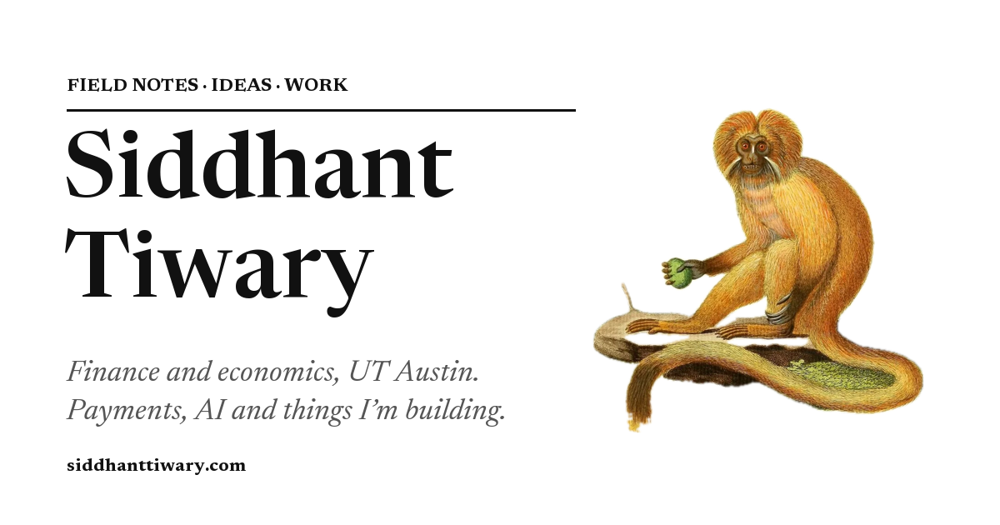

# siddhanttiwary.com

My personal site: ideas, work, projects, reading and music, laid out like an old natural-history field guide.

**Live:** https://siddhanttiwary.com



## What's here

- **Ideas** – short essays on payments, AI agents, game theory and DJing (`src/content/ideas/`)
- **Work** – where I've worked and what I did there
- **Creative projects** – including [Set](https://set-app-blush.vercel.app), an app for keeping the best moments of a DJ set
- **Articles, Songs & albums, About**

## How it's built

- [Astro](https://astro.build) static site, deployed on Vercel
- One typeface (Newsreader); no CSS framework
- The monkeys are cut out of public-domain, hand-coloured plates in Schreber's *Die Säugthiere* (1774–1846) and Elliot's *A Review of the Primates* (1913), using Apple's Vision foreground mask plus a small Python script (`tools/printlook.py`). Every plate is credited on [/credits](https://siddhanttiwary.com/credits).
- Each section page is a magazine spread: the monkeys are placed by percentage beside the text, so adding pictures never makes a page longer.

## Run it locally

Needs Node.js 22+.

```bash
npm install
npm run dev     # http://localhost:4321
npm run build   # production build into dist/
```
